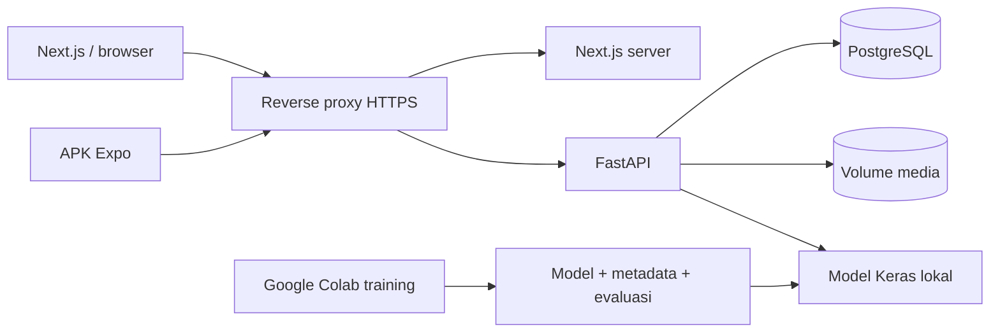
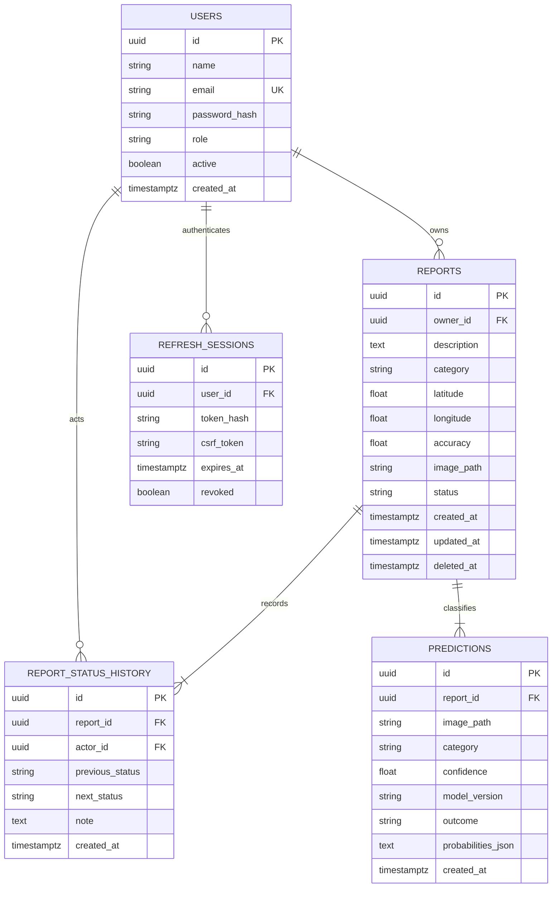

# Arsitektur dan ERD

Smart Waste menggunakan backend FastAPI modular tunggal. Next.js dan Expo mengonsumsi kontrak OpenAPI yang sama; logika izin, status, statistik, dan klasifikasi akhir berada di backend. TensorFlow hanya diperlukan untuk inferensi ketika model Colab dipasang. Model tidak melakukan panggilan ke OpenAI dan tidak memerlukan API key untuk prediksi.

## Keputusan data

- Role: `admin`, `user`. Status: `pending`, `in_progress`, `completed`, `rejected`. Kategori: `organic`, `paper`, `plastic`.
- Registrasi publik mengabaikan role tambahan dan selalu menghasilkan User. Akun nonaktif dan sesi revoked tidak dapat menggunakan access token yang belum kedaluwarsa sekalipun.
- User hanya mengedit/mengarsipkan laporan Pending miliknya. Admin dapat mengoreksi data semua laporan dan mengarsipkannya; status final tidak dibuka ulang.
- Semua foto tersimpan dengan nama UUID acak. Tidak ada media publik tanpa pemeriksaan izin. Foto asli diganti oleh JPEG yang dinormalisasi dan tanpa EXIF.
- Soft delete mempertahankan audit dan foto. Tidak ada fitur hard delete dalam aplikasi.
- Prediksi saat submit dihitung kembali oleh server, tidak dipercayai dari payload client. Mengubah foto membuat catatan prediksi baru; mengoreksi kategori tidak mengubah hasil AI asli.
- Filter tanggal menggunakan hari UTC secara inklusif; antarmuka menampilkan waktu sesuai zona perangkat.
- PostgreSQL adalah target deployment. SQLite hanya fallback development/test cepat; CI juga menguji PostgreSQL.

## Keamanan sesi

Access JWT 15 menit memuat subject dan ID sesi. Refresh opaque 7 hari disimpan sebagai SHA256, dirotasi, dan penggunaan ulang token lama mencabut seluruh sesi tersebut. Browser memakai cookie HttpOnly Secure pada HTTPS; mutation memakai CSRF token yang terikat sesi dan pengecekan Origin. Mobile menyimpan token di SecureStore dan mengirim Bearer, tidak menggunakan cookie.

Rate limit login/register adalah in-memory per worker, 10 percobaan per 15 menit. Jalankan satu worker API pada demo. Untuk deployment multiworker gunakan limiter bersama seperti Redis sebelum memperluas kapasitas. Proxy API hanya internal dan meneruskan alamat client; jangan membuka port API langsung dengan konfigurasi trusted proxy ini.
