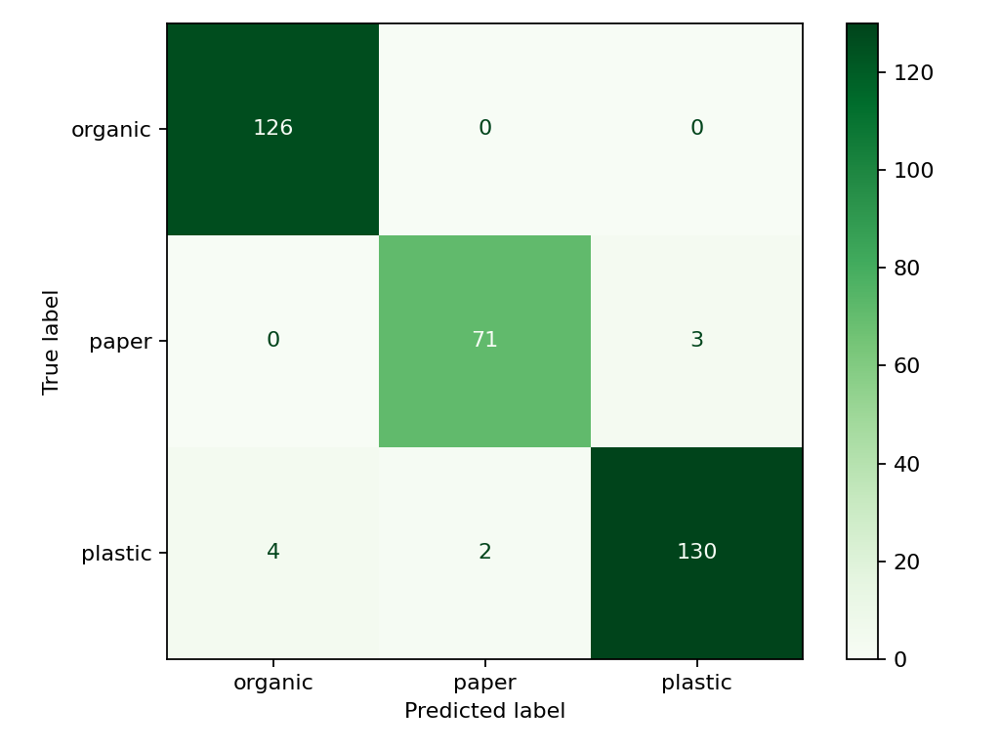
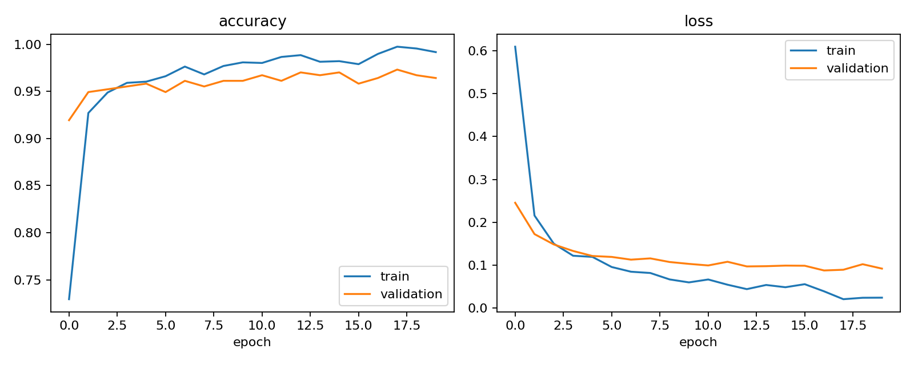

# Evaluasi model nyata — 2 November 2026

Training dijalankan di Google Colab GPU T4, TensorFlow 2.20.0/Keras 3.12.0, seed 42. Source training dan manifest berasal dari commit `1990bd8`; perbaikan instruksi restart berikutnya tidak mengubah training atau split eksperimen ini.

## Data dan pemilihan model

RealWaste UCI, CC BY 4.0, dengan atribusi Single, Iranmanesh, Raad, dan Wollongong City Council. Organic = Food Organics + Vegetation; Paper tidak termasuk Cardboard; Plastic = Plastic. Lihat [dataset dan lisensi](../../docs/dataset.md).

Setelah pemeriksaan gambar/duplikasi, tersedia 2.234 gambar unik: 1.563 training, 335 validation, dan 336 testing. Manifest Colab dibandingkan secara baris dengan `ml/manifests/manifest.csv` dan cocok persis. Kelompok SHA256/dHash tidak melintasi split.

MobileNetV2 pretrained ImageNet memakai RGB 224×224 dan rescaling di dalam model. Classification head dilatih 15 epoch (Adam 1e-3). Fine-tuning memakai lapisan akhir dengan BatchNorm tetap frozen, Adam 1e-5, early stopping patience 3; berhenti setelah 5 epoch. `fine.keras` dipilih berdasarkan validation loss terbaik pada fine-tuning epoch 2, **bukan** berdasarkan testing. Testing dijalankan setelah checkpoint dipilih.

## Hasil testing

**Accuracy: 97,3214% (327 benar / 336), melampaui target 80%.** Macro F1: 0,9723; weighted F1: 0,9731. Angka berasal dari `evaluation.json` dan dihitung ulang dari `test_predictions.npz` oleh `ml/verify_artifacts.py`.

| Kelas   | Precision | Recall |     F1 | Support |
| ------- | --------: | -----: | -----: | ------: |
| Organic |    0,9692 | 1,0000 | 0,9844 |     126 |
| Paper   |    0,9726 | 0,9595 | 0,9660 |      74 |
| Plastic |    0,9774 | 0,9559 | 0,9665 |     136 |

Baris adalah label sebenarnya, kolom adalah prediksi. Terdapat 3 Paper → Plastic, 4 Plastic → Organic, dan 2 Plastic → Paper.

## Artefak dan integrasi

- Versi: `mobilenetv2-20261102T140525Z`.
- SHA256 model.keras: `8dad4fd02b22995442def54afa1407db00e078890c614e392c7ed5836f455840`.
- Urutan output: `organic`, `paper`, `plastic`.
- Input API: gambar dinormalisasi EXIF/RGB/JPEG, kemudian PIL bilinear 224×224 float32 0..255; rescaling tidak diterapkan dua kali.
- Model dipasang pada volume model sandbox dan readiness mengonfirmasi `model_loaded: true`.
- [Smoke test API nyata](live_api_smoke.json) memakai sampel testing pertama per kelas, seluruhnya diprediksi sesuai label. Ini pemeriksaan integrasi tiga sampel, terpisah dari evaluasi 336 gambar.
- Koreksi kategori manual, dua prediksi setelah penggantian foto, transisi sampai Completed, dan penolakan edit final berhasil diperiksa. Akun/laporan sintetis dinonaktifkan/diarsipkan setelah uji.

Model dan ZIP hasil asli disimpan di `ml/artifacts` secara lokal, di luar Git biasa. Rilis model akan memuat model, metadata, evaluasi, checkpoint, manifest, dan checksum. File evaluasi kecil di direktori ini adalah keluaran asli Colab; tidak ada angka contoh atau hasil mock.

## Batas penggunaan

Evaluasi mengukur subset tiga kelas RealWaste, bukan seluruh sampah di dunia nyata. Tidak ada kelas 'bukan sampah'; model tidak dapat menjamin penolakan objek di luar domain. Confidence belum dikalibrasi. Perbedaan kamera, pencahayaan, sampah campuran, dan lokasi dapat menurunkan hasil. Kategori tetap saran yang dapat dikoreksi; confidence <70% meminta pemeriksaan manual. Tidak ada eksperimen lanjutan yang dipilih berdasarkan hasil test ini.
